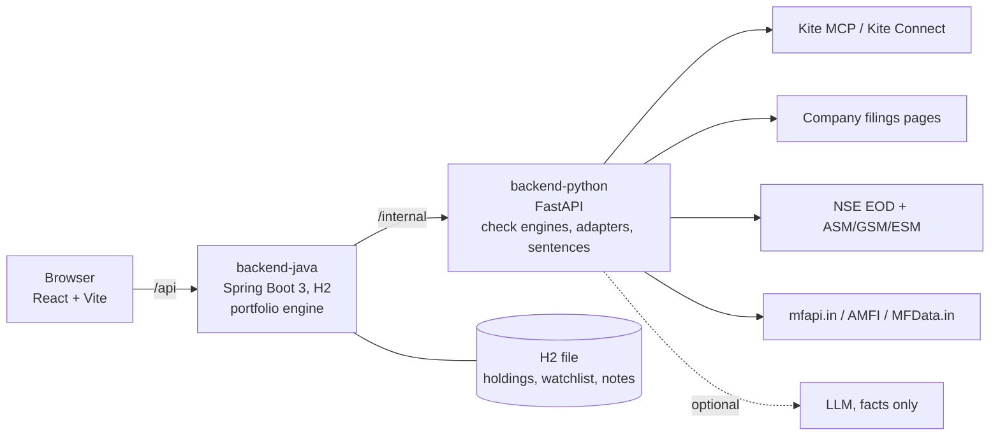

# Stock & Fund Checker (prototype)

A web app for a beginner investor in India who is building a personal portfolio. It imports holdings from Zerodha Kite, shows what the user really owns across stocks and mutual funds (looking inside the funds), checks any stock or fund against one fixed checklist, lets the user "try on" an amount or SIP, and keeps a watchlist with notes.

**Information only.** The app states facts and findings. It never gives buy/sell views, scores, ratings, targets or verdict words. An automated test scans every template, glossary entry and generated sentence for banned words.

Everything runs in **mock mode by default**: no keys, no network. Bundled sample data (15 stocks, 9 funds, a sample user, price/NAV history, Nifty 50, surveillance lists) is clearly marked "Sample data" in the UI. Two of the sample stocks and all nine fund houses are made up, so that no real company is tied to an invented pledge or surveillance flag.

## Quick start (mock mode)

Needs Python 3.11+, Java 21 + Maven, Node 20+.

```bash
./run-dev.sh        # starts Python (8000), Java (8080) and the frontend (5173)
# open http://localhost:5173  ->  Connect  ->  Connect Zerodha Kite (mock connects instantly)
```

Or with Docker: `docker compose up --build`. Or `make setup && make dev`.

The script picks the newest Python 3.11+ it finds (or the one in `$PYTHON`) and rebuilds `backend-python/.venv` if it was made with an older Python or is missing packages. On macOS the built-in `python3` is 3.9, so install a newer one first: `brew install python@3.12`. Java 21 is required; check `java -version` and `mvn -v` both report 21. Java takes about 15 seconds to start, so the first few `/api` proxy errors from Vite at launch are expected.

## Architecture



- `frontend/` React + TypeScript + Tailwind + Recharts + React Router. Talks only to Java. Holds no finance maths.
- `backend-java/` the only API the browser calls. Owns user data and all portfolio maths (look-through exposure in basis points that sum to exactly 100%, fund overlap = sum of the lower weight per common stock, cost, mix, returns vs Nifty 50, try-it-on). The maths is a pure-Java package (`engine/`) with no framework imports.
- `backend-python/` called only by Java. Owns data adapters, the stock-check and fund-check engines (five answers + eight facts each), statement parsing, glossary (54 terms) and every user-facing sentence. Sentences are deterministic templates; an optional LLM may only rephrase already-computed facts and falls back to the template if its output has a banned word or a number not in the facts.
- `docs/api-contract.md` is the single contract between the three. `PLAN.md` has the design; `DECISIONS.md` and `QUESTIONS.md` have choices made and questions for the owner.

## Switching adapters to live

Copy `config/app-config.example.yaml` to `config/app-config.yaml` (git-ignored) and change `adapters.*`. Both backends read the same file (`APP_CONFIG` env var overrides the path).

| Setting | Values | Notes |
|---|---|---|
| `adapters.broker` | `mock`, `kite_mcp`, `kite_connect` | `kite_mcp` talks to `https://mcp.kite.trade/mcp`; the login step returns a URL to open in a browser. `kite_connect` needs `kite.apiKey`, `kite.apiSecret` and `kite.redirectUrl` registered in the Kite developer console. Only read tools/endpoints are on an allow-list; order and GTT calls are refused before any network call. |
| `adapters.fundamentals` | `mock`, `screener` | Fetches public company pages server-side, cached 24h, one request per `screener.minIntervalSeconds`, optional `screener.sessionCookie`. Figures are labelled "Company filings"; the source name is never shown in the UI. |
| `adapters.prices` | `mock`, `broker_then_nse_eod`, `nse_eod` | |
| `adapters.surveillance` | `mock`, `nse` | NSE ASM/GSM/ESM CSV files. |
| `adapters.fundNav` / `fundMeta` / `fundHoldings` | `mock`, `mfapi` / `amfi` / `mfdata` | Live fund meta from AMFI gives category only; expense ratio, size and exit load are shown as "Not available" unless the bundled starter data knows the scheme. |
| `adapters.statement` | `auto`, `casparser`, `fallback` | Add `casparser` via `backend-python/requirements-optional.txt`; otherwise a built-in pypdf + pdfplumber parser is used. |
| `llm.provider` | `none`, `anthropic`, `openai` | Needs `llm.model` and `llm.apiKey`. Never committed. |

Other values (ports, cache durations, size-band cut-offs, H2 path) are documented inline in the example file. No secret is hard-coded; `config/app-config.yaml` is git-ignored.

## What was verified, and what was not

The build environment had **no access to package registries** (npm, PyPI, Maven Central refused) and no access to the live data sources. Nothing was worked around.

Verified by running (re-run before the final commit, see `make verify-local`):

- Python: `python -m pytest -q` in `backend-python` (423 tests, including facts, overlap inputs, the verdict-word scan over all templates, glossary and the full check output for every sample stock and fund, broker guard, statement parsing incl. an encrypted PDF).
- Python service end to end: `scripts/smoke_internal.py` starts a real uvicorn server with the Starlette fallback app and calls every `/internal` route in mock mode (31 checks).
- Java engine: `backend-java/tools/engine-check.sh` compiles the pure-Java engine and its tests with plain `javac` and a tiny JUnit stand-in and runs them (72 tests: overlap, look-through summing to 100%, try-it-on, cost, mix, concentration, returns, rupee formatting, narration keys).
- Frontend lib: `tsc -p tsconfig.lib.json` and `tsx --test src/lib/*.test.ts` (32 tests incl. Indian number formatting and the banned-word scan of all UI copy); `npm run check:fixtures` type-checks real Python responses against the TypeScript API types.
- The Java service layer was run in memory (stubbed Spring/JPA types, real Jackson) against the live Python service in mock mode: import, portfolio, home, checks, compare, search, explain, try-it-on, watchlist, statement import all returned the contract shapes.

**NOT verified (never compiled, built, rendered or run):**

- `mvn compile/test/spring-boot:run` against real Spring, JPA, H2 (Maven Central unreachable). The two Spring tests have never been compiled.
- `npm install`, `vite build`, Tailwind output, Recharts rendering, the real `@types/react` / react-router typings; nothing in the UI has been seen in a browser. Expect a few type or layout fixes on first run.
- `backend-python/app/main.py` (the FastAPI wiring; fastapi was not installed). The runnable fallback app uses the same route table.
- `docker compose` (images not built).
- Every live adapter (Kite MCP / Connect, company pages, NSE, mfapi, AMFI, MFData.in) and casparser. They were checked only on hand-written fixtures, fake transports and a loopback MCP server. `backend-python/AGENT-NOTES-live.md` lists each behaviour that is unverified against the real service.
- The optional LLM path against a real provider.

## Known limits

- Single local user, no login. Kite holdings carry no buy dates, so "since buying" returns are shown only where a date is known.
- Returns are price/NAV only (no dividends), not XIRR. SIP in "try it on" is modelled as 12 equal instalments at today's price.
- Live mode leaves some fields empty (fund expense ratio and size from AMFI, valuation history, results dates); the UI says "Not available" and never invents a figure.
- Sample figures are illustrative, not real market data.
- Out of scope: other brokers, tax, alerts, news, mobile app, order placement (refused by a guard).

Per-service notes written during the build: `backend-python/AGENT-NOTES-core.md`, `backend-python/AGENT-NOTES-live.md`, `backend-java/AGENT-NOTES.md`, `frontend/AGENT-NOTES.md`.
